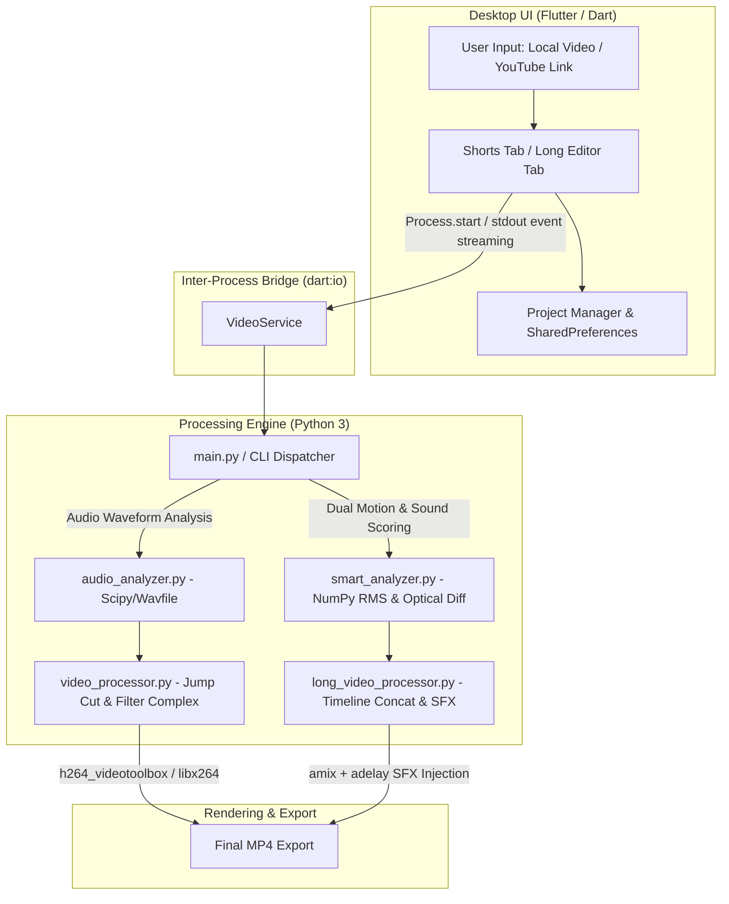

<div align="center">

# 🎬 AutoShorts Studio
### AI-Powered Video Editing & Shorts Automation Desktop Suite

[](https://flutter.dev)
[](https://dart.dev)
[](https://www.python.org)
[](https://ffmpeg.org)
[](https://apple.com)
[](https://opensource.org/licenses/MIT)

**AutoShorts Studio** is a high-performance desktop application designed to automate long-form and short-form video editing using intelligent audio-visual analysis, silence detection (Jump-Cut), automated 9:16 vertical re-framing, and dynamic SFX insertion.

[Features](#-features) • [Architecture](#-architecture) • [Tech Stack](#-tech-stack) • [Installation](#-installation--setup) • [Hardware Acceleration](#-hardware-acceleration--limitations) • [Project Structure](#-project-structure) • [Security & Privacy](#-security--privacy)

</div>

---

## 🌟 Features

### ⚡ 1. Auto-Shorts Creator (Vertical 9:16)
- **Audio Waveform Energy Peak Detection:** Automatically analyzes the video's audio track using moving-window RMS (Root Mean Square) energy to identify the most engaging, high-energy moments.
- **Smart Jump-Cut Engine:** Detects and cuts out dead air and pauses within clips using FFmpeg `silencedetect` without desynchronizing audio.
- **9:16 Vertical Formatting (1080x1920):**
  - **Center Crop:** Center-focused 9:16 crop ideal for podcasts and talking-head videos.
  - **Blur Background:** Blurred widescreen background with sharp foreground overlay for gaming and widescreen b-roll.
- **YouTube Link Support:** Direct download and processing via `yt-dlp` using headless streaming.

### ✂️ 2. Smart Long Video Editor
- **Dual-Factor Timeline Analysis:** Combines audio RMS energy levels with low-resolution optical pixel variance (motion score) to differentiate between active speech/action and dull scenes.
- **Automated Silence & Inactivity Trimming:** Eliminates repetitive pauses and empty frames automatically.
- **Dynamic Transition SFX:** Procedurally generates or layers custom transition sound effects (*Whoosh*, *Pop*, or *Random*) at cut boundaries using FFmpeg `amix` and `adelay`.

### 📱 3. Lossless USB Device Import
- Direct integration with native macOS Image Capture to import pristine 4K/60fps video files directly from smartphones over USB without cloud or chat compression.

### 📂 4. Project & Workspace Management
- Non-destructive project workspace with instant re-editing, duration calculations, file size estimations, and soft-delete (Trash/Restore) support.
- Fully customizable storage directory configurable from the UI.

---

## 🏗 Architecture



---

## 🛠 Tech Stack

| Component | Technology | Description |
| :--- | :--- | :--- |
| **Frontend UI** | [Flutter Desktop](https://flutter.dev) (Dart 3.x) | Modern dark-mode UI, `NavigationRail`, real-time log terminal, system notifications |
| **Orchestration** | Dart `dart:io` Subprocesses | Async event streaming, progress tracking, and exit code handling |
| **Audio Processing** | `SciPy`, `NumPy`, `Librosa` | RMS energy calculation, waveform parsing, moving-average filtering |
| **Video Engine** | [FFmpeg](https://ffmpeg.org) via `imageio-ffmpeg` | Hardware-accelerated decoding/encoding, complex audio-video filter graphs |
| **Hardware Codec** | Apple VideoToolbox (`h264_videotoolbox`) | Dedicated Apple Silicon M-Series hardware encoding (with CPU `libx264` fallback) |
| **Media Downloader** | `yt-dlp` | Headless YouTube media retrieval |

> [!NOTE]
> **Why Python instead of Node.js?**
> Video digital signal processing (DSP), frame differencing, and audio waveform RMS calculations require high-speed vectorized array operations. Python’s `NumPy` and `SciPy` libraries execute C-level vector math directly on CPU cache lines, making timeline analysis significantly faster than JavaScript runtimes.

---

## 🚀 Installation & Setup

### Prerequisites
- [Flutter SDK](https://docs.flutter.dev/get-started/install) (v3.12 or higher)
- [Python](https://www.python.org/downloads/) (v3.10 or higher)
- [FFmpeg](https://ffmpeg.org/download.html) (Installed on system path or auto-resolved via `imageio-ffmpeg`)

### Step 1: Clone the Repository
```bash
git clone https://github.com/muhammed1560/auto-shorts-studio.git
cd auto-shorts-studio
```

### Step 2: Configure Environment
Copy the environment template:
```bash
cp .env.example .env
```

### Step 3: Set Up Python Engine Dependencies
It is recommended to use a virtual environment:
```bash
cd engine
python3 -m venv .venv
source .venv/bin/activate  # On Windows: .venv\Scripts\activate
pip install -r requirements.txt
cd ..
```

### Step 4: Install Flutter Dependencies
```bash
flutter pub get
```

### Step 5: Run the Application
Launch the desktop application:
```bash
# macOS (Recommended)
flutter run -d macos

# Windows / Linux
flutter run -d windows
flutter run -d linux
```

---

## ⚙️ Hardware Acceleration & Limitations

### 🍏 Apple Silicon (M1 / M2 / M3 / M4) VideoToolbox
- **VideoToolbox Integration:** The rendering pipeline utilizes macOS hardware acceleration (`-c:v h264_videotoolbox`) with an 8 Mbps target bitrate, allowing full 60-second 1080x1920 renders in under **5–10 seconds**.
- **Cross-Platform Fallback:** On non-Apple platforms (Linux / Windows), the engine automatically falls back to software-based `libx264`.

### ⚠️ Known Constraints & Resource Guidelines
1. **CPU & RAM Utilization:**
   - Visual motion analysis samples video frames at 1 fps downscaled to 160x90 to protect system memory. Processing 4K 60-minute files temporarily requires approximately 2–4 GB of system RAM.
2. **Concurrent Workers:**
   - Multi-threaded clip extraction is throttled to 2 concurrent workers to prevent thermal throttling and ensure desktop UI responsiveness.
3. **FFmpeg Availability:**
   - Ensure `ffmpeg` is accessible in your system `PATH`. The engine automatically locates bundled executables via `imageio-ffmpeg` when available.

---

## 📁 Project Structure

```text
├── engine/                       # Python AI & Media Processing Engine
│   ├── assets/sfx/               # Synthesized audio assets (pop.wav, whoosh.wav)
│   ├── audio_analyzer.py         # Waveform RMS peak detection
│   ├── long_video_processor.py   # Multi-cut timeline stitching & SFX overlay
│   ├── main.py                   # CLI entrypoint for Shorts generator
│   ├── requirements.txt          # Python dependencies
│   ├── sfx_generator.py          # Waveform synthesis for transition SFX
│   ├── smart_analyzer.py         # Audio-visual motion & silence scoring
│   └── video_processor.py        # Jump-cut clip creation & 9:16 vertical render
│
├── lib/                          # Flutter Desktop Application (Dart)
│   ├── main.dart                 # App initialization & navigation layout
│   ├── long_editor_tab.dart      # Long-form video editing UI & timeline review
│   ├── project_manager.dart      # Workspace file persistence & project models
│   ├── projects_tab.dart         # Project browser, history, and trash bin
│   ├── shorts_tab.dart           # Auto-Shorts creation UI & terminal log view
│   └── video_service.dart        # Subprocess manager & engine path resolution
│
├── .env.example                  # Environment configuration template
├── .gitignore                    # Comprehensive Git exclusion rules
├── pubspec.yaml                  # Flutter package metadata & dependencies
└── README.md                     # Documentation
```

---

## 🔒 Security & Privacy

- **100% Local Processing:** All video cutting, audio filtering, and rendering occur entirely **locally on your machine**. No user video or audio data is ever uploaded to external cloud servers.
- **Portability:** Engine paths are resolved dynamically at runtime, ensuring complete portability across different user accounts and directories without hardcoded user paths.
- **Zero Secrets Tracked:** All environment files (`.env`), build caches, and system properties are strictly excluded by `.gitignore`.

---

## 🤝 Contributing

Contributions are welcome! If you find a bug or have an optimization idea:
1. Fork the Project.
2. Create your Feature Branch (`git checkout -b feature/AmazingFeature`).
3. Commit your Changes (`git commit -m 'Add AmazingFeature'`).
4. Push to the Branch (`git push origin feature/AmazingFeature`).
5. Open a Pull Request.

---

## 📄 License

Distributed under the MIT License. See `LICENSE` for more information.
